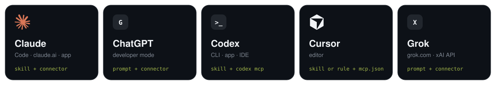
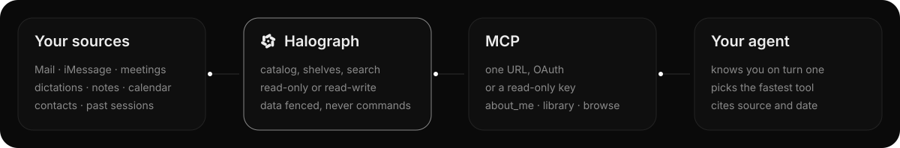

**One skill that teaches Claude, ChatGPT/Codex, Cursor and Grok to use your Halograph memory properly: fast, structured and safe.** Connect once, add the skill, and your AI knows you from the first message.



## How it works



Halograph collects your sources and organizes them like a library. Your AI reaches them over **MCP**. The **skill** teaches it to take the fastest path every time: `about_me` once, then `agenda` for dates, `browse` for topics and people, `search_context` for details, `read_note` for the full text.

---

## What is Halograph?

[Halograph](https://halograph.app) is a personal memory for AI agents. It automatically collects what is otherwise scattered everywhere:

| Area | Sources |
|---|---|
| Mail | Gmail, Outlook / Microsoft 365, Apple Mail (full text) |
| Messages | iMessage, WhatsApp and Telegram exports |
| Meetings | Granola (with transcript), Wispr Flow |
| Dictations | Wispr Flow, FluidVoice: everything you say, including your prompts to other AIs |
| Notes | Apple Notes, saved memories |
| Calendar | Apple, Google, Outlook, calendar links |
| People | Contacts |
| Work | GitHub repositories, Claude Code sessions, claude.ai and ChatGPT history |

Everything lives in one place, searchable and organized by topic, area and person, like a library. Any AI that speaks **MCP** (Model Context Protocol) can use it.

### What you use it for

- **No more explaining yourself:** the AI knows who you are, what you work on and how you like to work.
- **"What's on this week?"** It reads your real appointments, without family-only events and daily routines.
- **"What did I discuss with Anna about the offer?"** It finds the mails, messages and meetings.
- **"What did I miss?"** The newest items from every source in one step.
- **Pick up projects:** the AI reads earlier sessions, decisions and open points.
- **Remember things:** "Remember that I like short mails" stays available to every AI.

### What matters

- **Data is never a command.** Mails and messages are written by other people. Halograph fences every piece of content as data, and the skill teaches the AI never to follow instructions found inside it.
- **Read only for bots you don't fully trust.** Read-only keys can search but never write to your memory.
- **Origin stays visible.** Every memory an AI writes carries the name of that AI.
- **Revoke access any time** in Halograph under Settings → Connect (MCP).
- **This repository contains no personal data and no keys**, only the instructions for the AI.

---

## What you need

1. A Halograph account with connected sources.
2. The server address: **`https://halograph.app/api/mcp/context`**
3. Two steps per platform: **(A) connect MCP** and **(B) add the skill or instructions.** Without (A) the AI has no access, without (B) it often won't use it on its own, or not efficiently.

## Quick overview

| Platform | (A) Connect | (B) Instructions for the AI | Sign-in |
|---|---|---|---|
| **Claude Code** | `claude mcp add …` | copy `skills/halograph` to `~/.claude/skills/` | browser (OAuth) |
| **claude.ai / Claude app** | Settings → Connectors | upload the skill as a zip | browser (OAuth) |
| **Cursor** | `~/.cursor/mcp.json` | `skills/halograph` to `~/.cursor/skills/` or `cursor/halograph.mdc` | browser (OAuth) |
| **ChatGPT** | Settings → Apps & Connectors → Developer mode | `chatgpt/instructions.md` in a project or GPT | browser (OAuth) |
| **Codex (CLI, app, IDE)** | `codex mcp add …` + `codex mcp login` | `skills/halograph` to `~/.codex/skills/` | browser (OAuth) |
| **Grok app (grok.com)** | grok.com/connectors → Custom | `grok/system-prompt.md` in project instructions | browser (OAuth) |
| **Grok via the xAI API (your own bot)** | `tools: [{type:"mcp", …}]` | `grok/system-prompt.md` as `instructions` | read-only key |

Get the skill once:

```bash
git clone https://github.com/eliasconrad/halograph-skills.git
cd halograph-skills
```

After each step, **restart the app or session**: tools and skills are loaded at start.

---

## Claude Code

**(A) Connect**

```bash
claude mcp add --transport http --scope user halograph https://halograph.app/api/mcp/context
```

Then run `/mcp` in Claude Code → `halograph` → **Authenticate** → **Allow** in the browser.

**(B) Skill**

```bash
mkdir -p ~/.claude/skills && cp -r skills/halograph ~/.claude/skills/
```

**Check:** in a new session, without mentioning Halograph, ask "What's on my calendar this week?" → Claude calls `agenda`.

## claude.ai and the Claude app (Mac, Windows, iPhone)

**(A) Connect:** Settings → **Connectors** → **Add custom connector** → name `Halograph`, URL `https://halograph.app/api/mcp/context` → **Connect** → **Allow**.

**(B) Skill:**

```bash
cd skills && zip -r halograph.zip halograph
```

Settings → **Capabilities** → **Skills** → **Upload skill** → `halograph.zip`.

**Tip:** under Settings → Profile → Personal preferences add: *"Use Halograph whenever a question is about me, my projects, people or appointments. Call about_me first in new conversations."*

## Cursor

**(A) Connect:** add to `~/.cursor/mcp.json`:

```json
{ "mcpServers": { "halograph": { "url": "https://halograph.app/api/mcp/context" } } }
```

Restart Cursor → Settings → **MCP** → click **Needs login** next to halograph → **Allow**.

**(B) Skill or rule** (either one):

```bash
mkdir -p ~/.cursor/skills && cp -r skills/halograph ~/.cursor/skills/      # skill
mkdir -p ~/.cursor/rules  && cp cursor/halograph.mdc ~/.cursor/rules/      # rule
```

## ChatGPT

Custom MCP servers are available in ChatGPT through **Developer mode** (paid plans; on Business/Enterprise an admin has to allow custom connectors).

**(A) Connect:** Settings → **Apps & Connectors** → **Advanced** → turn on **Developer mode** → **Create** → name `Halograph`, URL `https://halograph.app/api/mcp/context`, authentication **OAuth** → **Allow**. In a chat, enable Halograph from the tools menu.

**(B) Instructions:** paste `chatgpt/instructions.md` into a **Project** (project instructions) or a custom **GPT** (instructions). For every chat: Settings → Personalization → Custom instructions (use the short version at the top of the file).

## Codex (CLI, Codex app, IDE extension)

Codex shares one configuration across CLI, app and IDE.

**(A) Connect**

```bash
codex mcp add halograph --url https://halograph.app/api/mcp/context
codex mcp login halograph      # opens the browser → Allow
```

**(B) Skill**

```bash
mkdir -p ~/.codex/skills && cp -r skills/halograph ~/.codex/skills/
```

Codex loads skills at start. Invoke it with `$halograph` or just ask a question. Alternatively copy the section from `codex/AGENTS.md` into `~/.codex/AGENTS.md`.

## Grok

### Grok app (grok.com, also for a Grok bot inside a project)

**(A) Connect:** [grok.com/connectors](https://grok.com/connectors) → **New Connector** → **Custom** → URL `https://halograph.app/api/mcp/context` → sign in → **Allow**. Requires a paid plan; on Grok Business an admin sets up the connector.

**(B) Instructions:** copy the "System prompt" section from `grok/system-prompt.md` into your bot's **project instructions**.

### Your own bot via the xAI API

A bot without a browser needs a key: in Halograph → Settings → Connect (MCP) → **Read only**. Keep the key in a secret store, never in code. See `grok/system-prompt.md` for the request.

---

## Does it work?

Three questions, without mentioning Halograph:

| Question | What the AI should do |
|---|---|
| "What's on my calendar this week?" | `agenda` |
| "What's new on project X?" | `library` → `browse topic=X` |
| "What did Anna write me last?" | `browse person=Anna` → `read_note` |

If the AI calls nothing: is (A) connected (green dot / "connected")? Is (B) added? Did you restart the session?

## The tools

| Tool | What for | Read only? |
|---|---|---|
| `about_me` | The full picture in one step (once per session) | yes |
| `library` | Catalog: shelves by topic, area and person | yes |
| `browse` | Open one shelf (topic, area, source, person, time range) | yes |
| `agenda` | Appointments in a date range, grouped by day | yes |
| `whats_new` | What's new across all sources | yes |
| `search_context` | Free search across all sources | yes |
| `search_library` | Only notes, memories and past sessions | yes |
| `read_note` | Read one entry in full | yes |
| `remember` | Save something durable | no |
| `log_conversation` | Log a session | no |
| `send_update` | Send the user a message in the app | no |

When each tool is fastest is described in the skill: [`skills/halograph/SKILL.md`](skills/halograph/SKILL.md).

## Files in this repository

| File | For |
|---|---|
| `skills/halograph/SKILL.md` | Claude Code, claude.ai, Cursor, Codex (Agent Skills format) |
| `cursor/halograph.mdc` | Cursor rule instead of a skill |
| `chatgpt/instructions.md` | ChatGPT (project, GPT, personalization) |
| `codex/AGENTS.md` | Codex without skills |
| `grok/system-prompt.md` | Grok app (project) and xAI API |
| `tools/` | Scripts that build the graphics in `assets/` |

## License

MIT
